# rocky-linux-admin-lab

This is a Rocky Linux admin lab, a good precursor project to a more Enterprise administration lab with more features

Rocky Linux download: https://rockylinux.org/download   
Downloaded Rocky Linux 9

# Setup
Name: Rocky Linux Lab   
Rocky 9 ISO 
Type: Linux with Red Selected   
Memory: 8192    
60 GB of disk   
NAT for Adapter 1   
Host only for Adapter 2 

After those inputs get Rocky Linux up which will take a few minutes.    
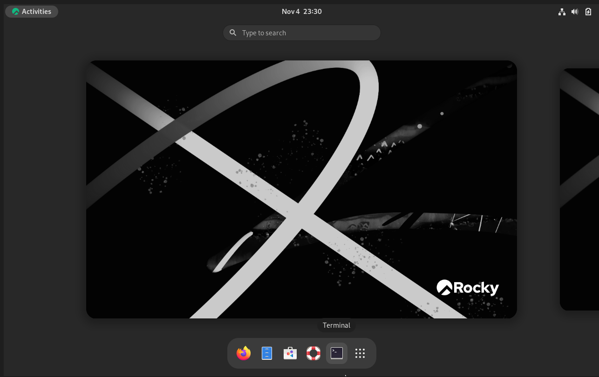    
Then run ip a in the terminal to get the address for enp0s8. After that run ping -c 3 google.com to check for network connectivity. 
After verifying, SSH into the Rocky Linux instance mainly so I don't have to escape out of the VM repeatealy.    
Then run sudo dnf update -y to update the system, then run sudo dnf install -y vim tar bash-completion net-tools bind-utils lsof. After that its time for the administration site of it.    

# Administration
We are going to create a user by typing sudo useradd -m -s /bin/bash alice, then type sudo passwd alice to give her a password. 
Then type sudo groupadd developers to create the developers group, then add alice to the group by typing sudo usermod -aG developers alice, then verify by running id alice and getent group developers to verify group membership for alice:   
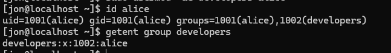    
To change the status of alice's account, lock by typing sudo usermod -L alice, to see status run sudo passwd -S alice, to unlock run sudo usermod -U alice, to change password run sudo chage -l alice, to set a password change date run sudo chage -M 90 alice.   
To verify alice can be reached type su - alice and it will switch to her.   
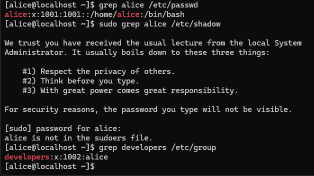  
What is being checked here is that /etc/passwd stores the password, /etc/shadow hashes the password so passwords can stay here, and /etc/group shows group membership.  
Delete the alice user and lets move on to file permissions. 

Lets create a folder called /srv/project by typing sudo mkdir -p /srv/project with /srv/ as the parent folder. Then add the devs group by typing sudo groupadd devs, then create a user by running sudo useradd -m -G devs bob with -m creating the user's directory.   
Then create another user that won't be added to devs called carol, then change the ownership of the folder to the devs by running sudo chown root:devs /srv/project and then permissions with sudo chmod 2770 /srv/project and then run ls -ld /srv/project to verify:  
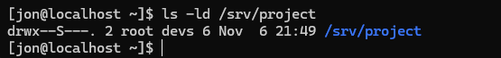  
To test out the permissons run these commands:  
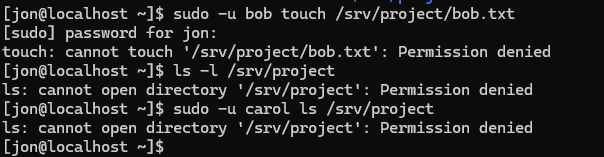  
Then another test as well after creating f.txt by typing touch f.txt:   
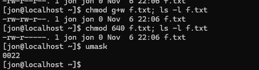    
This second test functions by changing permissions to add the ability to write for the owner of the file, which is the non-number form of 640.  
Then set up by only allowing users to delete their files:   
sudo mkdir /shared && sudo chmod 1777 /shared which creates the folder and assigns the permissions. 
sudo -u bob touch /shared/bobfile which gives bob ownership and ability to write to it. 
Then sudo -u carol rm /shared/bobfile which will deny carol from deleting it.   
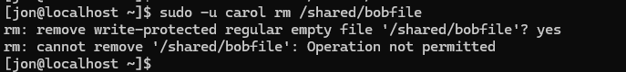  
For setting ACLs run sudo setfacl -m u:carol:rw /srv/project which will grant carol read and write access to the folder.    
Then run getfacl /srv/project to see the setup and then run sudo -u carol ls /srv/project to verify:    
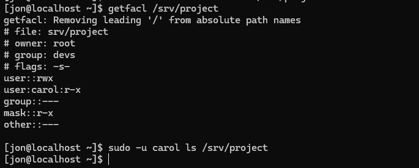  

To test this run name -l /srvproject/bob.txt to check and show permissions in the directory:    
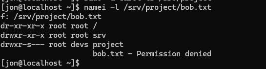    

Now lets move on to services by installing httpd with sudo dnf install -y httpd, then enable with sudo systemctl enable --now httpd and then check the status iwth systemctl status httpd and check the enabled status by running systemctl is-enabled httpd, restart with sudo systemctl restart httpd, reload with sudo systemctl reload httpd and stop with sudo systemctl stop httpd.   
Then create a service:  
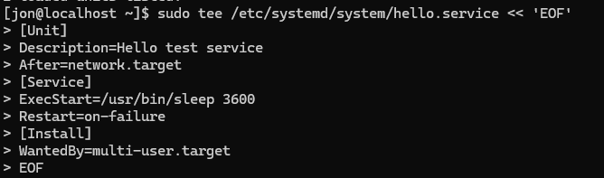    
Then run these commands to reload the daemon and enable hello:  
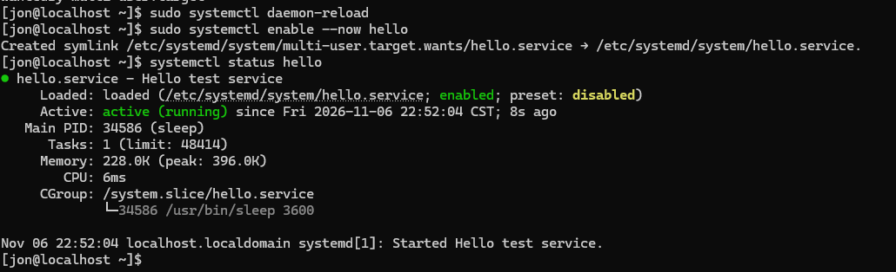    

Now lets move on to logs with journalctl by running journalctl -u httpd:    
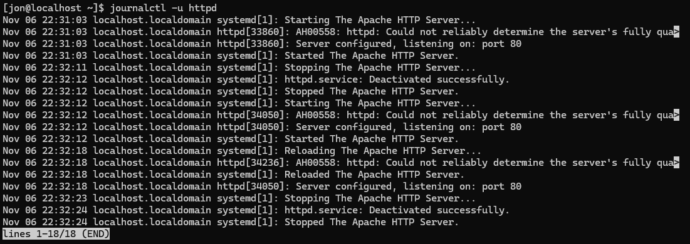    
Then run journalctl -p err -b to see errors since boot and journalctl --since "1 hour ago" to see errors from the past hour.    
Then run journalctl -b -l to see stuff from the previous boot then run journalctl --disk-usage to see disk usage taken up.  
To make log persist across boots run sudo mkdir -p /var/log/journal && sudo systemctl restart systemd-journald. 
For a break fix Linux scenario: 
sudo cp /etc/httpd/conf/httpd.conf /root/httpd.conf.bak 
sudo sed -i '1i BadDirective on' /etc/httpd/conf/httpd.conf to transform and search for the BadDirective portion.   
Then run sudo systemctl restart httpd and get the error code:   
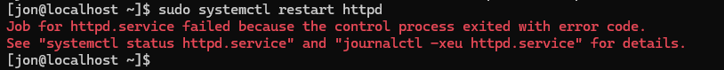    
Reason for the error is that BadDirective was turned on.    
Running sudo systemctl status httpd shows that the service has failed in active status. 
Then run journalctl -xeu httpd to view the error cause: 
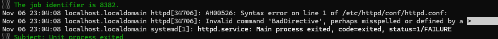  
Running sudo httpd -t confirms it as well:  
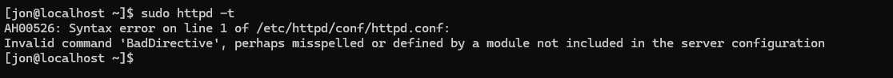    
With that out of the way fix by running sudo cp /root/httpd.conf.bak /etc/httpd/conf/httpd.conf and restart httpd.  

Now its time to move on to SSH